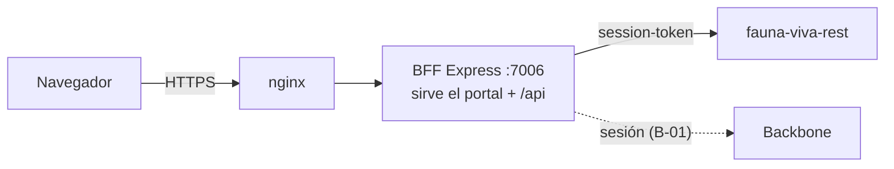

# fauna-viva-frontend — arquitectura

Portal Angular 22 y BFF Express 5 en un solo repositorio y una sola imagen Docker. El backend es `fauna-viva-rest`.
Sigue la estructura de `zerobound-frontend` y de `stratum`.

## Piezas

| Pieza | Tecnología | Dónde |
| --- | --- | --- |
| Portal | Angular 22, TypeScript 6, componentes standalone, señales, Tailwind CSS 4, `@ngx-translate` (es-VE) | `src/` |
| BFF | Node 24, Express 5, JavaScript CommonJS (`'use strict'`) | `server.js`, `server/` |
| Imagen | `node:24-alpine` en dos etapas, usuario `node`, `HEALTHCHECK` | `Dockerfile` |



## BFF

- `server.js` lee la configuración, ejecuta `settingsProblems()` y **termina con código 78** si falta algo obligatorio; luego arranca HTTP, o HTTPS si hay `SSL_CERT_PATH` y `SSL_KEY_PATH`.
- `server/app.js` exporta `createApp({ distPath })`: compresión, CORS solo para `CORS_ORIGIN` con credenciales, JSON de hasta 2 MB, límite de tasa por IP, traza W3C, `GET /health`, exigencia de la cabecera `x-fv-csrf: 1` en llamadas de escritura a `/api`, `404` JSON para `/api` desconocido y el build de Angular (con `index.html` para rutas del cliente). Sin build responde `503`.
- `server/config/constants.js` concentra las variables de entorno; `settings-check.js` decide si el BFF puede arrancar; `logger.js` usa winston.
- `server/shared/csrf.js` y `trace.js` (contexto de traza W3C, `X-Trace-Id`). `healthcheck.js` es la sonda del contenedor.
- `trust proxy` solo se acepta como número de saltos o direcciones. `TRUST_PROXY=true` se rechaza porque dejaría elegir la IP al cliente.

Lo que cada tarea siguiente añade: B-01 sesión con Backbone (`fv_session`, `fv_refresh`), B-02 proxy al backend con renovación silenciosa, B-03 estructura del portal por rol y selector de clínica.

## Portal

- `src/app/{core,shared,features}`; rutas cargadas de forma diferida; alias `@app`, `@core`, `@features`, `@env`.
- Textos en `public/i18n/es-VE.json`, cargados con `provideTranslateHttpLoader`. Idioma por defecto y de respaldo: `es-VE`.
- Estilos con Tailwind CSS 4; los colores de marca son tokens `--color-fv-*` en `src/styles.css` (la marca por clínica, P-08, los reemplaza).
- Las llamadas van a `/api/v1`; en desarrollo `proxy.conf.json` las envía al BFF.

## Calidad

| Qué | Cómo | Umbral |
| --- | --- | --- |
| BFF | `node:test` en `server/test/*.test.js`, `--experimental-test-coverage` | 85 % líneas, ramas y funciones (`pnpm test:bff:coverage`) |
| Portal | Karma + Jasmine + `karma-coverage` | 85 % sentencias, ramas, funciones y líneas (`pnpm test:coverage`) |
| Archivos sin prueba | `scripts/check-coverage-files.mjs` | falla si un `.ts` no aparece en el reporte |
| Todo junto | `pnpm test:all` y el workflow `ci.yml` | además compila producción y construye la imagen |

## Ejecutar

```bash
pnpm install
pnpm dev          # Angular en modo watch + BFF en :7006
pnpm test:all     # pruebas con umbrales
pnpm build && node server.js   # portal servido por el BFF en :7006
```

Variables: `.env.example`. Node 24 y pnpm 12 (versión fijada en `packageManager`).
