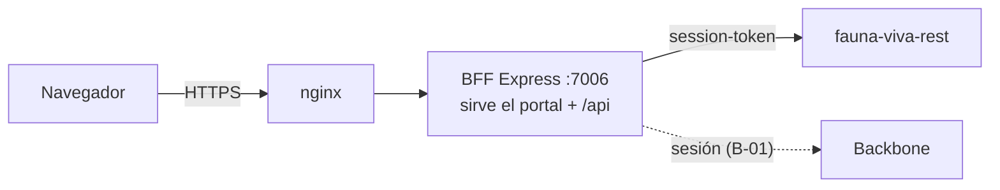
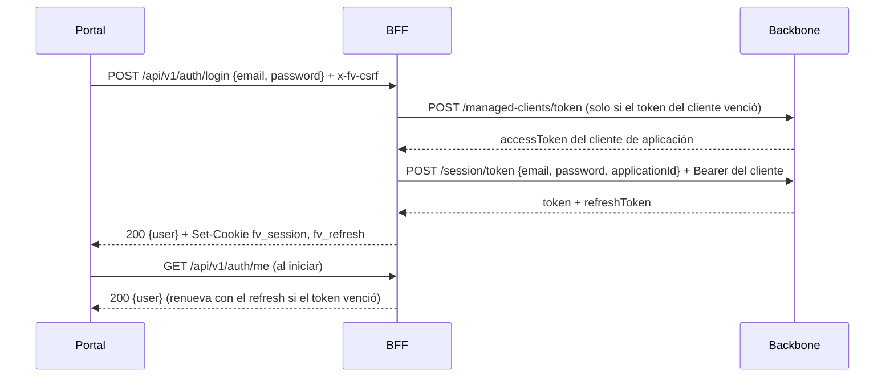

# fauna-viva-frontend — arquitectura

Portal Angular 22 y BFF Express 5 en un solo repositorio y una sola imagen Docker. El backend es `fauna-viva-rest`.
Sigue la estructura de `zerobound-frontend` y de `stratum`.

## Piezas

| Pieza | Tecnología | Dónde |
| --- | --- | --- |
| Portal | Angular 22, TypeScript 6, componentes standalone, señales, Tailwind CSS 4, `@ngx-translate` (es-VE) | `src/` |
| BFF | Node 24, Express 5, JavaScript CommonJS (`'use strict'`) | `server.js`, `server/` |
| Imagen | `node:24-alpine` en dos etapas, usuario `node`, `HEALTHCHECK` | `Dockerfile` |



## BFF

- `server.js` lee la configuración, ejecuta `settingsProblems()` y **termina con código 78** si falta algo obligatorio; luego arranca HTTP, o HTTPS si hay `SSL_CERT_PATH` y `SSL_KEY_PATH`.
- `server/app.js` exporta `createApp({ distPath })`: compresión, CORS solo para `CORS_ORIGIN` con credenciales, JSON de hasta 2 MB, límite de tasa por IP, traza W3C, `GET /health`, exigencia de la cabecera `x-fv-csrf: 1` en llamadas de escritura a `/api`, `404` JSON para `/api` desconocido y el build de Angular (con `index.html` para rutas del cliente). Sin build responde `503`.
- `server/config/constants.js` concentra las variables de entorno; `settings-check.js` decide si el BFF puede arrancar; `logger.js` usa winston.
- `server/shared/csrf.js` y `trace.js` (contexto de traza W3C, `X-Trace-Id`). `healthcheck.js` es la sonda del contenedor.
- `server/shared/backbone.js`, `session.js`, `cookies.js`, `proxy.js` y `server/routes/auth.routes.js`: la sesión (ver «Seguridad»).
- `trust proxy` solo se acepta como número de saltos o direcciones. `TRUST_PROXY=true` se rechaza porque dejaría elegir la IP al cliente.

Lo que cada tarea siguiente añade: B-02 proxy al backend con renovación silenciosa, B-03 estructura del portal por rol y selector de clínica.

## BFF internals

El BFF es la única puerta al backend. Orden de los middleware en `createApp()`: `helmet` → compresión → CORS (solo `CORS_ORIGIN`, con credenciales) → JSON → cookies → límite de tasa global → traza → `/health` → exigencia CSRF en `/api` → rutas de autenticación → **proxy** → `404` JSON de `/api` → portal estático.

- **Proxy** (`routes/api.routes.js` + `shared/proxy.js`): toda llamada a `/api/v1/*` que el BFF no responda él mismo se reenvía a `fauna-viva-rest` tal cual, de modo que un módulo nuevo no requiere cambios aquí. Una pantalla que combine módulos agrega su propia ruta antes del proxy.
- **Qué viaja al backend**: `session-token` (desde la cookie; el que mande el navegador se ignora), `X-Clinic-Id`, `If-Match`, `Idempotency-Key` y `traceparent`. Los parámetros repetidos (`sort=a&sort=b`) se envían sin índices, como los lee Spring. No viajan cookies ni otras cabeceras del navegador.
- **Qué vuelve al navegador**: `ETag`, `X-Total-Count`, `Link`, `Content-Disposition` e `Idempotent-Replayed`, además del estado y el cuerpo; un `application/problem+json` conserva su tipo.
- **Renovación silenciosa**: ante un `401` del backend con refresh token, una sola renovación y un reintento; si Backbone rechaza el refresh, se borran las cookies y el portal recibe `401`. Sin refresh token, el `401` pasa tal cual.
- **Rutas con `..`**: una ruta que intente salir de `/api/v1` (incluso codificada, `%2e%2e` o `..%2F`) recibe `400` y nunca llega al backend.
- **Fallos**: backend caído = `502` con `traceId`, sin revelar la causa ni tocar las cookies.
- **Cabeceras de seguridad**: `helmet` con todo lo estándar salvo `Content-Security-Policy`, que queda pendiente (el CSS crítico en línea de Angular necesita un nonce por respuesta).
- **Límites**: global `RATE_LIMIT_MAX` por IP y ventana de 15 min, con `429` y `Retry-After`; `trust proxy` configurable para que cuente la IP real detrás de nginx.

## Seguridad

El navegador nunca ve un token: el BFF los guarda en cookies `httpOnly`, `SameSite=Lax` (`Secure` con `COOKIE_SECURE=true`) llamadas `fv_session` y `fv_refresh`, con la vida del refresh token. El portal solo recibe el perfil (`id`, `username`, `firstname`, `lastname`).



- **Cliente de aplicación**: el BFF se identifica ante Backbone con `BACKBONE_CLIENT_ID/SECRET`. Su token se guarda en memoria hasta un minuto antes de vencer y los inicios de sesión simultáneos comparten una sola petición. Si Backbone rechaza al cliente (token o permiso), el BFF responde `502` y registra un error de configuración: nunca se le atribuye al usuario.
- **Credenciales**: usuario inexistente, contraseña incorrecta y petición mal formada por Backbone responden el mismo `401 Invalid credentials`. Backbone `429` se traduce a `429`.
- **Límites**: `LOGIN_RATE_LIMIT_MAX` (10 cada 15 min por IP) en el login y `REGISTRATION_RATE_LIMIT_MAX` (20) en registro, verificación y reenvío; el undécimo intento recibe `429` con `Retry-After`.
- **Registro del apoderado**: `/auth/register`, `/auth/verify-email` y `/auth/resend-verification` reenvían solo los campos documentados (el navegador no puede elegir rol, aplicación ni `active`), sin cookies, con la IP del visitante en `X-Forwarded-For`.
- **Cierre de sesión**: `POST /auth/logout` revoca ambos tokens en Backbone y borra las cookies pase lo que pase.
- **Portal**: `AuthService.restore()` corre en `provideAppInitializer` (un `F5` no pide la clave de nuevo); `authGuard` protege `/` y `guestGuard` deja `/login` y `/registro` solo a visitantes; `authInterceptor` agrega `x-fv-csrf` a toda llamada a `/api/v1` y, ante un `401` que no venga del login ni de `/auth/me`, olvida la sesión y lleva al login.

## Portal

- `src/app/{core,shared,features}`; rutas cargadas de forma diferida; alias `@app`, `@core`, `@features`, `@env`.
- Textos en `public/i18n/es-VE.json`, cargados con `provideTranslateHttpLoader`. Idioma por defecto y de respaldo: `es-VE`.
- Estilos con Tailwind CSS 4; los colores de marca son tokens `--color-fv-*` en `src/styles.css` (la marca por clínica, P-08, los reemplaza).
- Estructura por rol, clínica activa, interceptores y formatos: ver [`docs/tecnica/portal/estructura.md`](tecnica/portal/estructura.md).
- Las llamadas van a `/api/v1`; en desarrollo `proxy.conf.json` las envía al BFF.

## Calidad

| Qué | Cómo | Umbral |
| --- | --- | --- |
| BFF | `node:test` en `server/test/*.test.js`, `--experimental-test-coverage` | 85 % líneas, ramas y funciones (`pnpm test:bff:coverage`) |
| Portal | Karma + Jasmine + `karma-coverage` | 85 % sentencias, ramas, funciones y líneas (`pnpm test:coverage`) |
| Archivos sin prueba | `scripts/check-coverage-files.mjs` | falla si un `.ts` no aparece en el reporte |
| Todo junto | `pnpm test:all` y el workflow `ci.yml` | además compila producción y construye la imagen |

## Ejecutar

```bash
pnpm install
pnpm dev          # Angular en modo watch + BFF en :7006
pnpm test:all     # pruebas con umbrales
pnpm build && node server.js   # portal servido por el BFF en :7006
```

Variables: `.env.example`. Node 24 y pnpm 12 (versión fijada en `packageManager`).
